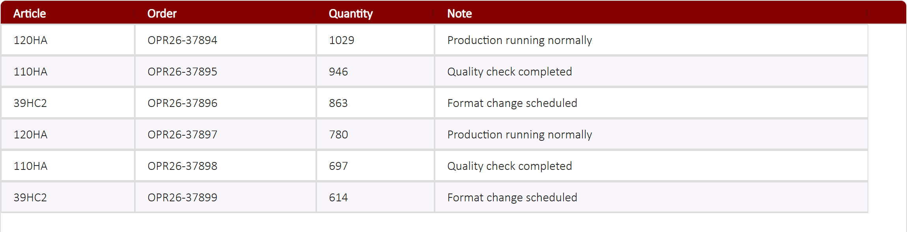
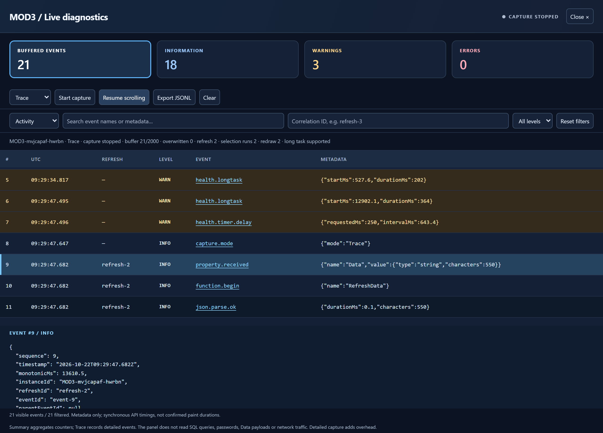

# MOD3 — user guide

Updated 22 October 2026. Import [GB_AGGridSQLWidget_mod3.cwp](../../GB_AGGridSQLWidget_mod3.cwp). Internal identity: GB_AGGridSQLWidget_mod3. The native widget still exposes 27 properties.

## Grid and diagnostics

These 2× browser screenshots use synthetic data and a simulated host, not an AVEVA production environment. Open each image at its original resolution to read the metadata. Capture and scrolling were paused for a stable screenshot; the grid data is illustrative.

## Installation

1. Export the existing symbols and save their CWP packages.
2. Import MOD3 and create or update a test wrapper, typically GBDataGrid2_MOD3.
3. Bind Columns, Data, RowsToSelect, configuration inputs and selection outputs to the wrapper. Importing a CWP does not guarantee that bindings are transferred.
4. Keep MOD2 unchanged until the comparison tests pass.
5. Click the grid and press **Ctrl+Alt+D**. Allow popups for the site/runtime. The requested window is 1100 × 760 and resizable; the browser may open a tab instead.
6. Close with Esc, Close, Ctrl+Alt+D or the window X. Closing the source page also closes the popup.

## Inspecting logs

| Control | Meaning |
|---|---|
| Summary | Default mode: counters, summaries and anomalies |
| Trace | Detailed events; use temporarily during investigation |
| Off | Disables diagnostic collection and health monitors, not existing wrapper logs |
| INFO / WARN / ERROR cards | Filter buffered events by level; counts are not historical totals |
| Search and refresh ID | Narrow the list by event metadata and correlation |
| Event name | Select a record and display its JSON metadata |
| Reset filters | Clear search, correlation, level and view; keep the captured events |
| Pause scrolling | Freeze the displayed list while collection continues |
| Stop capture | Stop diagnostic recording without stopping the grid |
| Export JSONL | Export the whole retained buffer, not just filtered rows |
| Clear | Clear the buffer and counters; export first if needed |

The five views are Activity, Performance, Properties, Rendering and Errors. The buffer retains up to 2,000 events; the list shows the last 200 filtered rows. The open panel refreshes every 500 ms. Closing it stops its UI timer, not collection. Event timestamps use UTC.

## Performance and limitations

Idempotent selection, coalesced timers and caches reduce repeated work. Diagnostics cover property notifications, JSON parsing, instrumented API calls and observed timer delays. They do not capture network packets, SQL queries or Data/cell contents.

Synchronous JavaScript timings are not confirmed paint durations. A long task does not identify SQL as its cause. Local browser results do not guarantee one-second updates in the plant runtime.

The [optimized SQL loader](./Wrapper_SQL/LEGGIMI_Ottimizzazione_SQL.md) avoids identical publications and unnecessary column rebuilding but remains **synchronous**. It requires two private wrapper CPs: RefreshInCorso Boolean=False and CacheConfigurazioneColonne String empty. These are not new native widget properties. Compile and test the loader in the AVEVA IDE.

## Acceptance and rollback

Test real queries, empty datasets, editing, selection, focus, popup permissions, exports, repeated open/close cycles, multiple instances and duplicate loaders. Compare MOD2/MOD3 using identical data and refresh rates. Restore the previous symbol and CWP for rollback; no database migration is required.

## Further information

- [Detailed technical guide](./Guida_MOD3_Uso_Diagnostica_Performance.md)
- [Source](../../src/GB_AGGridSQLWidget_mod3/)
- [HTML5 guide](../../index.html#mod3)

Existing file and CP names are retained for compatibility, even where they originate from an Italian project.
